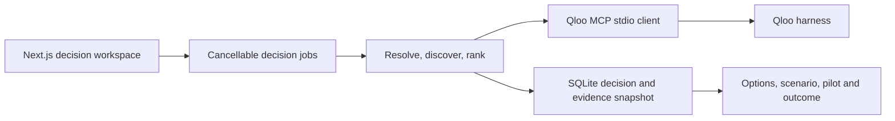

# Tastewell: current functionality

Snapshot: 2026-10-28. This document describes the code currently in this
repository and the latest local verification. It is a baseline for
[the product plan](PRODUCT_IMPLEMENTATION_PLAN.md), not a list of promised
features. `IMPLEMENTATION.md` records the earlier hackathon build history;
`HANDOFF.md` records recent runs and environment details.

## What a user can do today

**Decision workspace:** `/` and `/decision` accept a venue concept,
audience, objective, up to ten venues with live-music and budget inputs, and
up to five operator-supplied artist names. The venue list can be populated
from a validated four-column CSV
(`name,region,live_music_allowed,budget_limit`); import replaces the visible
venue fields and is capped at ten rows. It does not upload a file by itself.
The workspace resolves the Qloo concept tag,
asks the operator to choose ambiguous tag or artist matches, and either
discovers artists or resolves the supplied names with `describe`. It obtains
an optional brand suggestion and constructs up to three distinct programming
formats from the resolved artist IDs. When there are at least two artists,
`rank` compares the same artist shortlist in one call per eligible venue.
The matrix labels each venue's ordinal rank separately; it does not compare
affinity values across calls. A venue that disallows live music is excluded.
Budget feasibility remains unverified because fees and production costs are
unknown.

Each option opens typed evidence rows with query context, Qloo ID, status,
correlation ID, and retrieval time. The operator can select an option and
eligible venue, record a pilot owner, date, success measure, baseline, cost
assumption, and next action, then record an aggregated outcome against their
own baseline. Create, resolve, list, get, select, and outcome routes under
`/api/decisions` serve this path. The workspace starts creation and
resolution as cancellable jobs, displays the current stage and elapsed time,
and can ask the backend to stop a job. A 180-second total budget covers MCP
startup and data calls. A scenario form keeps the artist IDs fixed and
reranks one venue for a changed audience or region. It saves both query
contexts, ordinal ranks, and source rows without subtracting affinities
across calls. A saved decision can be exported as JSON or copied as a replay
that uses its saved evidence and makes no Qloo call; the replay is visibly
labeled and starts without a selected pilot or outcome. SQLite snapshots in
`backend/data/decisions.sqlite` survive a restart. There is no app-level
account or ownership control, so saved decisions are appropriate only for
local development or a password-protected private preview.
This slice does not verify booking availability, fee, staffing, licensing,
attendance, revenue, or causal impact.

The landing view also offers an instant, read-only illustrative decision.
It uses invented names, `urn:sample` IDs, source rows, ranks, a changed-audience
scenario, and a sample pilot plan. It makes no Qloo call or server write and
does not claim a real event or outcome. The live concept chooser labels tag
types in operator language, visually distinguishes a place-category match,
and still requires a human choice. For ambiguous artist records with the
same name, only their IDs currently distinguish the choices.

The standalone grounded-versus-generic brief page has been removed after
the 2026-10-28 live browser check. The product demonstrates Qloo's role with
source rows and changed-context ranks inside the decision workspace. The
older `/api/agent/*` backend path remains as an internal development harness
pending a dependency audit; no product route calls it.

**Agent review (2026-10-29):** A ready live decision or saved-evidence replay
can start one bounded pilot review from the workspace. The model can inspect
saved option rows, check operator-supplied venue facts, and request one new
fixed-shortlist Qloo rank only for an operator-confirmed alternate audience
or region on a live decision. Replays cannot make a new Qloo call. A review
uses at most four model turns and a 90-second total budget, can be cancelled,
and saves its action record and evidence fingerprint in SQLite and JSON
exports. A recommendation requires a successful artist source, inspection of
the chosen option, and a check of the chosen eligible venue. The server
constructs its factual rationale from validated rows and constrains the next
check to an existing unknown. Invalid model output gets one repair attempt,
then an explicit abstention. An unavailable model leaves the deterministic
options intact. An older review is marked stale when evidence or scenarios
change; selecting a pilot still requires the operator's explicit plan form.
The invented instant example has no agent review.

## Runtime path

- Frontend: `frontend/app/decision/page.tsx`,
  `frontend/app/decision/venueCsv.ts`, and `frontend/lib/api.ts`.
- Product HTTP API: `/api/decisions` and `/api/decision-jobs` in
  `backend/app/api/routes.py` and `backend/app/api/decisions.py`.
- Decision jobs: `POST /api/decision-jobs`, `GET`/`DELETE`
  `/api/decision-jobs/{job_id}`, and
  `POST /api/decisions/{id}/resolve-jobs`. Completed decisions persist;
  in-flight job status is in memory and disappears on restart.
- Scenario comparison: `POST /api/decisions/{id}/scenarios` reranks one saved
  shortlist for a changed audience or region and persists its evidence.
- Agent review: `POST /api/decisions/{id}/agent-reviews` starts an in-memory
  job; `GET`/`DELETE /api/decisions/{id}/agent-reviews/{review_id}` inspect or
  cancel it. Completed reviews persist with the decision and reopen after a
  restart.
- Snapshot tools: `GET /api/decisions/{id}/export` downloads the decision;
  `POST /api/decisions/{id}/replay` copies its evidence into a new labeled
  decision without a Qloo call.
- Execution: `backend/app/api/decisions.py` runs explicit Qloo stages and
  saves snapshots through `backend/app/api/decision_store.py`. Decision job
  status remains in memory during execution.
- Qloo boundary: `backend/app/qloo/mcp_client.py` manages the harness process
  and bounded tool retries;
  `backend/app/qloo/normalizer.py` maps the six envelope statuses.
- Internal legacy harness: `backend/app/agent/loop.py` and
  `backend/app/agent/provider.py` still serve `/api/agent/*` for development;
  no frontend route uses that path.

## What Qloo does in the product

The decision pipeline uses `find_tags` to resolve the concept,
`recommend` for artist and optional brand discovery, `describe` for supplied
artists, and `rank` over a shared artist shortlist per eligible venue.
Concept and artist ambiguity can require a human choice. The harness and
repository also have live probes/contracts for `describe`, `rank`,
`where_popular`, `compare_audiences`, `audience_demographics`, `entity_tags`,
and `trends`. The separate `qloo exec` adapter and its TTL cache support
development and probes. The MCP path has its own per-client, five-minute cache for
identical `ok` and `empty` requests. Error and degraded responses are never
cached; cache entries are cleared when that MCP session closes.

## Grounding and error behavior

The harness returns `ok`, `empty`, `needs_input`, `partial`, `degraded`, or
`error`. The product decision path stores typed source rows with Qloo IDs,
query context, status, correlation ID, and retrieval time. Ambiguous concept
or artist matches pause for a user choice. Missing evidence does not become
a model guess. Decision jobs have a 180-second total budget and can be
cancelled. The older model-driven brief path has separate retry and timeout
behavior, but no longer has a product UI.

## Verified state and limitations

Before the comparison removal, the full backend suite passed **87 tests, 2 skipped**; frontend lint,
production build, and three mocked decision browser journeys passed. A live browser
journey used the job API, resolved a public two-artist shortlist, ranked the
same IDs for two eligible venues, and saved a changed-audience scenario over
those IDs. On 2026-10-28 a live browser walkthrough of the current decision
path created three sourced artist-led options, changed the first two ranks
under a new audience, saved a sample pilot and an explicitly synthetic
outcome, and replayed saved evidence without another Qloo call.

- Artist and optional brand recommendations and artist rankings are actively
  queried in the product decision path. Audience, geography, and trend
  claims must stay within those results' actual meaning.
- Decision snapshots and operator-entered outcomes persist in local SQLite;
  in-flight jobs disappear on restart. There is no authentication, project
  history, or versioning; JSON export and saved-evidence replay exist.
- The app is local. `deploy/` contains a private-preview Compose package with
  Caddy password protection, but it has not been built on a Docker host or
  externally deployed. Root `README.md` and `LICENSE` are present.
- Qloo reports aggregate cultural affinity, not individual preference,
  purchase intent, causal effect, revenue, or a calibrated demand forecast.

## Contract constraints for future work

Read `docs/qloo-contract.md` before adding a workflow. In particular,
`rank` compares options **inside one call**; values from separate rank calls
must not be treated as a common score. `compare_audiences` expects entity
groups, not free-text demographic labels. `where_popular` returns geographic
affinity rows for an entity; it does not directly predict venue sales.
`trends` rejected place entities in live probing. Ambiguous names must be
resolved to chosen IDs before downstream use.
