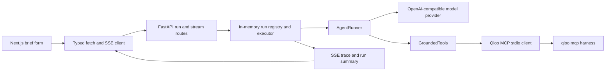

# Tastewell: current functionality

Snapshot: 2026-10-28. This document describes the code currently in this
repository and the latest local verification. It is a baseline for
[the product plan](PRODUCT_IMPLEMENTATION_PLAN.md), not a list of promised
features. `IMPLEMENTATION.md` records the earlier hackathon build history;
`HANDOFF.md` records recent runs and environment details.

## What a user can do today

**Experimental decision workspace:** `/decision` accepts a venue concept,
audience, objective, up to ten venues with live-music and budget inputs, and
up to five operator-supplied artist names. The venue list can be populated
from a validated four-column CSV
(`name,region,live_music_allowed,budget_limit`); import replaces the visible
venue fields and is capped at ten rows. It does not upload a file by itself.
The workspace resolves the Qloo concept tag,
asks the operator to choose ambiguous tag or artist matches, and either
discovers artists or resolves the supplied names with `describe`. It obtains
an optional brand suggestion and constructs up to three distinct programming
formats from the resolved artist IDs. When there are at least two artists,
`rank` compares the same artist shortlist in one call per eligible venue.
The matrix labels each venue's ordinal rank separately; it does not compare
affinity values across calls. A venue that disallows live music is excluded.
Budget feasibility remains unverified because fees and production costs are
unknown.

Each option opens typed evidence rows with query context, Qloo ID, status,
correlation ID, and retrieval time. The operator can select an option and
eligible venue, record a pilot owner, date, success measure, baseline, cost
assumption, and next action, then record an aggregated outcome against their
own baseline. Create, resolve, list, get, select, and outcome routes under
`/api/decisions` serve this path. The workspace starts creation and
resolution as cancellable jobs, displays the current stage and elapsed time,
and can ask the backend to stop a job. A 180-second total budget covers MCP
startup and data calls. A scenario form keeps the artist IDs fixed and
reranks one venue for a changed audience or region. It saves both query
contexts, ordinal ranks, and source rows without subtracting affinities
across calls. A saved decision can be exported as JSON or copied as a replay
that uses its saved evidence and makes no Qloo call; the replay is visibly
labeled and starts without a selected pilot or outcome. SQLite snapshots in
`backend/data/decisions.sqlite` survive a restart. There is no app-level
account or ownership control, so saved decisions are appropriate only for
local development or a password-protected private preview.
This slice does not verify booking availability, fee, staffing, licensing,
attendance, revenue, or causal impact.

**Existing brief demo:**

1. Choose one of nine venue presets or type a venue concept, region/catchment,
   and target audience. Presets fill the form; they do not submit it.
2. Click **Run both panes**. The browser starts a grounded Qloo run and a
   generic LLM-only run concurrently.
3. Watch run status and a merged live trace. The grounded pane shows MCP
   connection, model steps, Qloo calls, envelope statuses, and completion.
4. Read a concept brief with audience profile, menu tilt, music/programming,
   adjacent brands, tag themes, and honest absences. Citation IDs in section
   strings are associated with evidence chips when they match recorded IDs.
5. If Qloo returns an ambiguous candidate set, pick an entity/tag and re-run
   that pane with the chosen ID. Stop aborts browser stream consumption; the
   backend run itself continues until completion or timeout.

The generic pane illustrates what the model says without Qloo. It is a
demonstration aid, not a required part of the grounded workflow. That demo
has no save, share, revise, compare-options, or export journey.

## Runtime path

- Frontend: `frontend/app/TastewellApp.tsx`, `components/BriefForm.tsx`,
  `components/ResultPane.tsx`, `components/TracePanel.tsx`, and `lib/api.ts`.
- HTTP API: `POST /api/agent/run`, `GET /api/agent/stream/{run_id}`,
  `GET /api/agent/runs/{run_id}`, `GET /api/health`, and
  `GET /api/qloo/status` in `backend/app/api/routes.py`.
- Decision jobs: `POST /api/decision-jobs`, `GET`/`DELETE`
  `/api/decision-jobs/{job_id}`, and
  `POST /api/decisions/{id}/resolve-jobs`. Completed decisions persist;
  in-flight job status is in memory and disappears on restart.
- Scenario comparison: `POST /api/decisions/{id}/scenarios` reranks one saved
  shortlist for a changed audience or region and persists its evidence.
- Snapshot tools: `GET /api/decisions/{id}/export` downloads the decision;
  `POST /api/decisions/{id}/replay` copies its evidence into a new labeled
  decision without a Qloo call.
- Execution: `backend/app/api/engine.py` creates one async task per brief run,
  starts Qloo MCP for grounded mode, and keeps brief state in process memory.
  The separate decision path in `backend/app/api/decisions.py` runs explicit
  Qloo stages and saves snapshots through `backend/app/api/decision_store.py`.
- Agent: `backend/app/agent/loop.py` builds prompts, calls the model,
  dispatches tool calls, parses final JSON, and attaches evidence.
- Qloo boundary: `backend/app/agent/tools.py` compacts tool results for the
  model while retaining evidence metadata; `backend/app/qloo/mcp_client.py`
  manages the harness process and bounded tool retries;
  `backend/app/qloo/normalizer.py` maps the six envelope statuses.
- Model boundary: `backend/app/agent/provider.py` supports Gemini, OpenAI,
  Groq, and OpenRouter through compatible chat-completion APIs.

## What Qloo does in the shipped agent

The legacy brief model currently sees only two Qloo tools:

| Workflow | Current job | Evidence in the UI |
| --- | --- | --- |
| `find_tags` | Resolve the venue concept to Qloo tags. | Tag IDs and envelope metadata. |
| `recommend` | Find artists and brands from concept tags plus region and audience. | Returned entity IDs and envelope metadata. |

The system prompt asks for one concept tag lookup, one artist recommendation,
one brand recommendation, then a JSON brief. It tells the model to cite Qloo
IDs and leave unsupported sections empty. The UI displays an honest-absences
list when evidence is missing. The current `menu_tilt` can use only food,
cuisine, or amenity tags from concept resolution; it is not a validated menu
optimization or sales recommendation.

The decision workspace separately uses `describe` and `rank` through the MCP
client in its deterministic pipeline. The harness and repository have live
probes/contracts for `describe`, `rank`,
`where_popular`, `compare_audiences`, `audience_demographics`, `entity_tags`,
and `trends` as well. These are **not** exposed to the served agent by default.
The separate `qloo exec` adapter and its TTL cache support development and
probes. The served MCP path now has its own per-client, five-minute cache for
identical `ok` and `empty` requests. Error and degraded responses are never
cached; cache entries are cleared when that MCP session closes.

## Grounding and error behavior

- The harness returns `ok`, `empty`, `needs_input`, `partial`, `degraded`, or
  `error`. The client normalizes those shapes, and transient MCP errors get
  bounded retries.
- A `needs_input` response with candidates can be surfaced for a user pick.
  A zero-candidate dead end bans that tool family for the remainder of the
  run. Tag URNs are rejected in entity-only argument slots.
- Tool results sent to the model are compacted; full raw envelopes are not
  shown in the browser. Evidence metadata records operation, status, IDs,
  result count, summary, correlation ID, and timestamp.
- The LLM provider retries bounded 429/5xx failures and can shrink tool
  history after a 413. An empty or malformed final JSON gets up to two
  format-repair attempts without offering further Qloo tools. If parsing
  still fails, the run aborts rather than presenting a fabricated brief.
- Grounded MCP connection emits a status event immediately and has a
  90-second readiness timeout. Agent execution has a separate 600-second
  timeout. Disconnecting from SSE does not cancel the backend task.

## Verified state and limitations

The full backend suite passed **87 tests, 2 skipped**; frontend lint,
production build, and three mocked decision browser journeys passed. A live browser
journey used the job API, resolved a public two-artist shortlist, ranked the
same IDs for two eligible venues, and saved a changed-audience scenario over
those IDs. The older brief
path also completed a live grounded taco-shop/Austin/young-families run with
four model steps and 19 trace events.

- The legacy demo outputs a narrative brief. The separate `/decision` path
  asks for a programming objective and compares concrete pilot formats.
- Nine presets are convenience inputs, not nine distinct decision workflows.
- Only artist and brand recommendations are actively queried in the served
  agent. Audience, geography, and trend claims should stay within those
  results' actual meaning.
- The current app does not independently verify every final prose claim
  against raw Qloo rows after model generation; the prompt and displayed
  evidence provide the main guardrails. Citation chips appear only for IDs
  found in recorded evidence.
- Brief run state and traces are in memory and disappear on restart. Decision
  snapshots and operator-entered outcomes persist in local SQLite. There is
  no authentication, project history, versioning, or export.
- The app is local. `deploy/` contains a private-preview Compose package with
  Caddy password protection, but it has not been built on a Docker host or
  externally deployed. Root `README.md` and `LICENSE` are present.
- Qloo reports aggregate cultural affinity, not individual preference,
  purchase intent, causal effect, revenue, or a calibrated demand forecast.

## Contract constraints for future work

Read `docs/qloo-contract.md` before adding a workflow. In particular,
`rank` compares options **inside one call**; values from separate rank calls
must not be treated as a common score. `compare_audiences` expects entity
groups, not free-text demographic labels. `where_popular` returns geographic
affinity rows for an entity; it does not directly predict venue sales.
`trends` rejected place entities in live probing. Ambiguous names must be
resolved to chosen IDs before downstream use.
